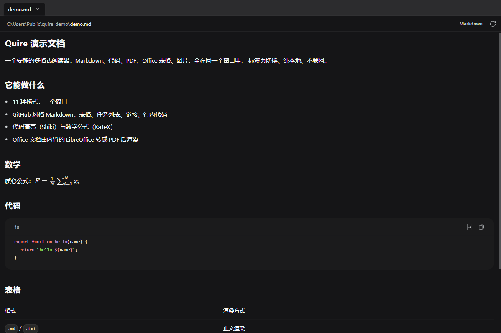
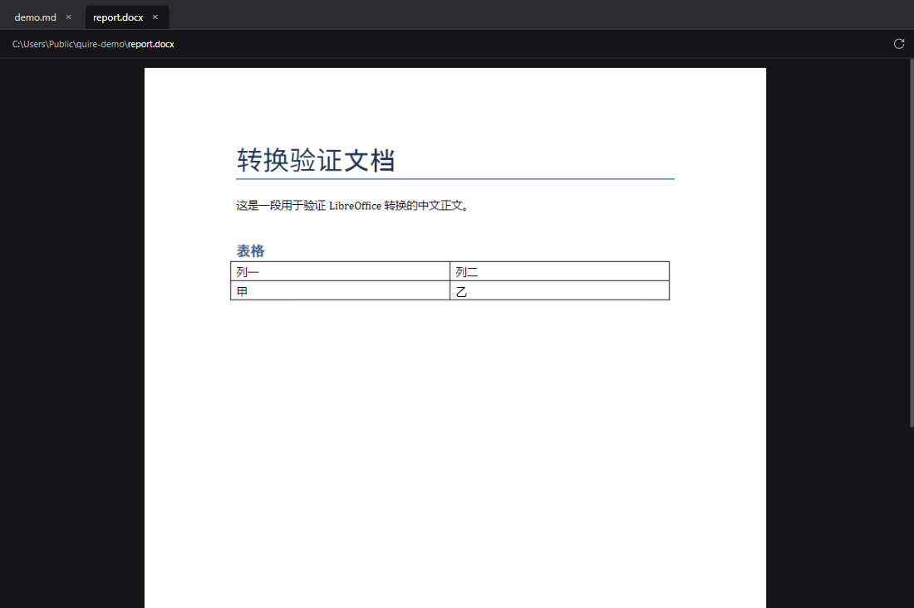

# Quire

[](LICENSE)

**一个安静、纯本地的 Windows 文档阅读器。** 11 种格式、一个窗口、标签页切换；没有账号、没有遥测、不联网（除非你打开的文档自己引用了外部资源）。

Quire 把 DeepSeek Harness（DSH）侧边栏那套文档预览完整抽出来，重写成不依赖 DSH 的独立应用：渲染器原样使用 DSH 公开发布的客户端包，宿主接口由本项目实现。

> **English summary** — Quire is a local, multi-format document reader for Windows, extracted from the DeepSeek Harness sidebar. It renders Markdown, code, HTML, PDF, images, Word, PowerPoint, Excel and CSV in one tabbed window, with Office files converted by a bundled LibreOffice. No account, no telemetry. Licensed MIT; not affiliated with DeepSeek (see [NOTICE](NOTICE)).






## 特性

- **一个窗口读完**：标签页 + 正文，没有目录树、没有文件浏览器，文档只从"打开/拖入/双击关联"进来。
- **11 种格式**：Markdown（GFM：表格、任务列表）、代码高亮（Shiki，含行号与跳转）、数学公式（KaTeX）、HTML、PDF（文字层可选）、图片、Word、PowerPoint、Excel、CSV/TSV。
- **Office 由内置 LibreOffice 转 PDF**：`.docx/.pptx/.xlsx` 等在本机转换，不上传任何文件。
- **按需加载**：PDF.js 与表格引擎各是 6 MB+ 的惰性分块，只有打开对应文件时才加载。
- **纯本地**：无账号、无遥测、无自动更新；Office 转换结果只在内存里缓存（8 份 / 128 MiB LRU）。
- **单实例**：应用已开着时双击文档，会交接给已有窗口，而不是再开一个进程（实测约 0.13 s）。

## 三种安装方式

1. **绿色版**（推荐）：下载 `Quire-portable.zip`，解压后双击 `Quire.exe`。不写注册表、不需要管理员。
2. **`install.ps1`**（解压出来的目录里）：`powershell -ExecutionPolicy Bypass -File install.ps1` — 逐个复制文件、建桌面与开始菜单快捷方式、写"打开方式"与卸载信息，**完全不经过自解压/临时目录**。卸载加 `-Uninstall`。
3. **安装包 `Quire-Setup.exe`**：标准 NSIS 向导，按用户安装（默认 `%LOCALAPPDATA%\Quire`，无需管理员），建快捷方式、注册卸载项，并登记进"打开方式"。

> **首次运行会被 SmartScreen 拦一下**：安装包与 exe 都没有代码签名，Windows 会显示"已保护你的电脑 → 发布者未知"。点「仍要运行」即可。这是所有未签名软件的常态；请只从本仓库的 Releases 下载。

## 使用

- 打开：**把文件拖进窗口**、`Ctrl+O`、或双击已关联的文件类型（安装时会登记"打开方式"）。
- 多文档：每个文件一个标签，横向滚动；`Ctrl+W` 关标签。
- 主题：`视图 → 深色主题`，选择会被记住。
- 宿主的"根目录"只为**解析文档里的相对引用**保留（Markdown 的相对图片、HTML 的相对 `.js`/`.css`），取该文档所在目录。

## 隐私与安全边界

- **不联网**：应用自身没有任何网络请求。Office 转换、PDF 解析、表格计算全在本机。
- **写入**：只写自己的配置与日志（`%APPDATA%\Quire\`），不改你的文档；转换产物只落在内存里。
- **HTML 预览会执行文档自带的脚本**——这是刻意的，否则用 JavaScript 画的图表（ECharts 之类）永远是空白。因此：
  - 预览运行在 `sandbox="allow-scripts"` 的**无源 iframe** 里，拿不到宿主桥、读不到父窗口；
  - 文档自己引用的 `https` 资源（例如 CDN 上的图表库）会被加载，**这意味着预览一份不受信任的 HTML 时，它可以看到你的 IP**；
  - 外壳的 CSP 只放行预览所需的内容，导航离开本页、`window.open`、`webview` 一律拒绝（`npm run verify:security` 会回归这 8 项）。
- **没有代码签名**：无法证明二进制与你构建的源码一致。要完全可信就自己构建（见下）。

## 从源码构建

仓库里**不含任何第三方二进制**（DSH 的渲染器 bundle、192 MB 的 LibreOffice 引擎、180 MB 的 Electron 运行时都不进 git）；`tools/fetch-vendor.mjs` 按固定版本从公开 npm 取回它们，并逐个校验 SHA-256：

```powershell
npm install                          # 依赖（含 Electron 33.4.11 运行时）
node tools/fetch-vendor.mjs          # 取回 DSH 渲染器 bundle + LibreOffice 引擎 + Electron 运行时
npm run build                        # 构建 shell 到 dist/web
npm run package                      # 组装 release/Quire
npm run package:all                  # 再生成 NSIS 安装包与绿色版 zip
npm run verify:package               # 产物完整性体检（不需要运行程序）
```

- `fetch-vendor.mjs` 从 `@deepseek-ai/dsh-client-ui-sidebar-documentpreview@0.1.7-rc.2`（MIT）与 `@deepseek-ai/dsh-client-ui-theme@0.1.7-rc.2`（MIT）取 bundle，从 `@deepseek-ai/libreoffice-kit@0.1.2`（MPL-2.0）取引擎；上游若换了产物，脚本会因为哈希不符**直接失败并让你先看 diff**。
- 想跑一遍回归：`npm run verify:all`（单元 + 契约 → 启动应用 → 应用行为 → 安全边界 → 可执行脚本预览 → 严格 canvas → 11 种格式 → 可选 200 MB 大文件）。
- 只想开发界面：`npm run dev`（开发服务器）或 `npm run desktop`（用仓库里的 Electron 启动）。

## 技术说明

```
渲染器 bundle（原样 vendor，一行不改）
        │  运行期只 require react / react-dom / dsh-client-store / dsh-client-ui-primitives
        ▼
src/renderer/dsh/          ← 宿主桥接层
  bridge.js                __ModuleLoader__ 契约 + 平台模块表 + require.async 分块加载
  shell-runtime.js         ctx 服务面：effect / locale / slots / reflect / sidebarRightTabs / configForms
  slot-service.js          槽位声明与派发（含真实 SlotCore 的声明语义与三态 hook 合成）
  resources.js             资源元数据流（文件版本 → 自动刷新）
  boot.js                  装配以上并 apply(渲染器)
        ▼
src/renderer/App.jsx       ← 外壳：多标签 + 把正文挂到 sidebar.right.pane.tab
src/renderer/main.jsx      ← 启动：桌面桥接 → 页面 HTTP → 验证宿主，三选一
        ▼
src/main/host-api.js       ← 宿主文件服务（readPage / readBytes / stat / raw）
src/main/office-converter.js ← Office → PDF（有界队列 + LRU + 引擎临时目录隔离）
src/main/electron-main.cjs ← Electron 主进程：窗口、IPC、dsh-file:// 协议、菜单、单实例交接
src/preload/preload.cjs    ← 把 host / remote 两个面暴露给渲染器
```

**阅读器实际要的宿主面**（实测，不是推测）：`ctx.inject(["remote"])` 的 `workspaceFiles.read/readBytes` 与 `officeToPdf.render/generation`、`ctx.locale`（8 个命名空间）、`ctx.sidebarRightTabs.register`、`ctx.slots`、`ctx.reflect.provide("documentPreviews")`、`ctx.effect`、`ctx.configForms.developerTools.enabled`。

**打包不走打包器**：Electron 的 `resources/app` 目录优先于 `resources/app.asar`，所以一次构建就是"拷贝 + 一份清单"，产物可以原样读回来。图标与版本块由 `rcedit` 写进 exe（否则它只是 `electron.exe` 的副本，资源管理器里显示 Electron 图标、属性写着 `GitHub, Inc.`）。

### 实测数据（2026-10-13，Windows 11 / NVMe）

| 动作 | 耗时 |
|---|---|
| 冷启动打开一个 Markdown | 690–1088 ms（中位 801 ms） |
| 应用已开着时双击同一个文件（第二实例交接） | 126–134 ms |
| 同一次会话里重复打开同一份 docx（转换缓存命中） | 87–137 ms |
| 首次打开一份 docx（含 LibreOffice 转换） | 2.1–3.3 s |
| 200 MB 文本：第 1 页 / 文件中段翻页 | 4 ms / 316 ms |

### 验证

`npm run verify:all` 依次跑：单元 + 契约测试（18 项）→ 启动应用 → 应用行为 → 安全边界（8 项）→ 可执行脚本预览 → 严格 canvas → 11 种文档格式 →（可选）200 MB 大文件。另有：

| 检查 | 内容 |
|---|---|
| `verify:package` | 发布体检：29 个运行时必需文件、清单可解析、惰性分块就位、Office 引擎依赖图可解析、CSP 存在、无 source map |
| `verify:security` | 导航离开本页被拒、`window.open` 被拒、预览框架拿不到宿主桥、脚本化预览能跑脚本但没有桥 |
| `verify:html` | 可执行脚本预览回归：离线夹具里的图表只能由内联脚本画出，空 canvas 即失败 |
| 真实应用内目视 | ECharts 报告在打包应用里画出三根柱子（canvas 34,460 个彩色像素）；docx 经 LibreOffice 渲染出表格 |

## 已知限制

- **首次打开一份 Office 文档约 2 秒**（LibreOffice 转换的物理成本）；同一份文件再次打开约 0.1 秒（内存缓存），**重启应用后缓存即失效**。
- **表格预览上限**可能拒绝真实文件：判据是「最高行 × 最高列」（跨可见工作表累加），所以对整列设过格式的表会瞬间到 `XFD`。默认 `maxCells: 250000`、`maxBytes: 16 MiB`——**与 DSH 的一致，刻意不做偏离**；可在 `bootReader({ config: { excel: … } })` 覆盖。
- **Office 预览不支持工作簿里的图片与条件格式**（阅读器会在顶部说明并建议用系统应用打开）。
- **未在本机复核**：PDF 文字层的选区与缩放、行号导航跨页推进时的高亮标记。
- 只有 Windows x64 发布；没有代码签名。

<details>
<summary><b>开发札记：重写宿主时踩过的 36 个坑</b>（点击展开）</summary>

1. **槽位必须先声明**。`SlotCore.register` 对未声明槽位直接抛错，声明只由父条目 `children` 产生；`root` 是 a-priori 且 `single`，外壳种子条目只能有一个，且它被销毁会连带**塌陷所有子声明**。
2. **渲染器先注册正文、后声明槽位**。`apply$9…apply$3` 先往 `sidebar.right.tab.document` 注册，`TextPreview` 的 `children` 后声明它。若外壳预先声明，注册会抛 `already declared`；`slot-service.js` 的做法是捕获冲突 → 撤掉种子声明 → 重新注册父条目 → 父条目销毁后补种。
3. **`hooks` 舱有三种形态**，各自变成不同的 prop：可观察源（订阅）、工厂 `(standard, hookContext) => hook`（返回 hook）、普通值（`interactivePreview` 是布尔值，直接透传）。只实现"可观察源"会让 HTML 渲染器崩在 `source.getSnapshot is not a function`。
4. **`useTabInfo` 是槽位级 hook**，工厂签名 `(standard, hookContext) => hookContext`；外壳必须自己提供（`tabInfoHookFactory`），否则正文一渲染就 `useTabInfo is not a function`。
5. **资源第一帧必须是 `live`**。字节渲染器要等 `meta.status !== 'none'` 才读字节；首次 stat 因版本未变而不发帧，会让 PNG 永远停在「文档渲染中…」。
6. **模块加载器的 facade 必须持久**。vendor bundle 是 ES 模块，一个 URL 只求值一次；用"临时 facade + finally 还原"会在第二次 boot 时丢掉注册。改成常驻 facade 委托给桥接表后，缓存命中也正确。
7. **`configForms.developerTools.enabled`** 决定 HTML 预览是可执行脚本的沙箱 iframe 还是静态 CSP 预览。外壳由 `main.jsx` 显式传 `interactiveHtmlPreview: true` 打开它：默认关着时，靠 JavaScript 画的图（ECharts 之类）永远是空白——空 div 只有脚本跑起来才会有柱子，而同一份文档在浏览器里正常，看起来就像「应用丢了数据」。
8. **`import()` 不接受 Windows 绝对路径**，必须 `pathToFileURL`（`office-converter.js` 的 `importSpecifier`）。
9. **OOXML 准入检查自相矛盾**：`libreoffice-kit` 的过滤器只收 `[Content_Types].xml` 与 `word|xl|ppt/**/*.xml`，但准入检查又要求存在 `_rels/.rels`。手工构造夹具时两个条件都得满足。
10. **手写 ZIP 写入器的两个陷阱**：通用标志位不能只设 bit 3 而漏写数据描述符（fflate 报 `unexpected EOF`）；中央目录条目的 local header offset 必须写真实值，否则所有条目都指向第 0 个（同样报 `unexpected EOF`）。
11. **设计令牌必须由主题插件提供**。`shell.css` 引用 91 个 `--dsw-*` 令牌，其中 90 个没有兜底值；阅读器自己的 10 张注入样式表另引用 24 个。这些令牌**只由 `@deepseek-ai/dsh-client-ui-theme` 在运行期注入**。缺了它，`font: var(--dsw-font-markdown-base)` 这类**简写**因无值被判整条无效，排版回落到浏览器默认（标题 `2em`、边距 `32px/16px`、无颜色无边框）——这正是"两侧效果完全不同"的根因。
12. **主题插件要三样外壳服务**，缺一个都起不来：`ctx.provide(name, value)`（`ctx.reflect.provide` 之外的等价别名）、`ctx.configForms.get("ui-theme")` 返回的设置宿主（`getSnapshot()/set()/subscribe()`，**默认值必须是 `{ preference: "system", fontSize: 14 }`**——它在构造时无条件 adopt 宿主的值，空对象会让 preference 变成 `undefined` 并抛 `theme registry lost "undefined"`）、以及**槽位缺失时的容忍**（它往 `settings.general.item` 注册两行设置，而本外壳没有这个座位）。
13. **`root` 是 `single` 槽**：外壳种子条目只能有一个，且**销毁父条目会塌陷它声明的全部座位**。所以每次新增种子座位都得"先撤旧条目、再造一个声明全部座位的新条目"，不能增量补。
14. **"无出口的贡献"要 acknowledge 而非实现**：插件带来的、外壳没有对应 UI 的槽位注册，应当返回一个空 disposer 并记录，而不是替它声明座位——否则同一座位的第二次注册会因为 `single` 冲突而失败。
15. **`package.json` 的 `"type": "module"` 不能删**。主进程是 `.cjs`，但它 `await import()` 的 `host-api.js` / `file-service.js` / `office-converter.js` 都是 `.js` + `import` 语法，**只有这个字段能让 Node 把它们当 ESM**。删掉后的表现是：窗口不出现、`boot.log` 只有一行、`unhandledRejection: Cannot use import statement outside a module`。`tools/preflight-app.mjs` 会逐个 `import()` 这三个文件，把这类错误挡在打包之前。
16. **`app.getPath('userData')` 用的是 `productName`**，不是 `name`。日志因此在 `%APPDATA%\Quire\boot.log`：它每次启动都会记，能直接说明走到了哪一步（`window created` / `page finished loading`）。改名（`productName`）等于换目录，旧设置与日志不会迁移。
17. **被会话/沙箱接管的目录里的文件会带 Low 完整性级别**（`icacls <文件>` 最后一行可见），从这种目录启动的进程继承该级别，Chromium 建沙箱时 `CHECK` 失败、以 `0x80000003` 退出，**任何 JS 都不执行、日志一行不写**。三组对照：同目录内失败 → 同样字节复制到普通目录正常 → 原地把整棵树改成 `Medium` 立刻正常。要在受限目录内验证界面，先把文件复制出去。
18. **启动参数可能是文件而非目录**：`"打开方式"` 关联传进来的是文件路径。早期版本把第一个路径参数直接当 `workspaceRoot`，于是去列一个文件、必然失败。现在按 `statSync` 区分：目录当根、文件取其父目录当根并在页面加载后打开该文件。
19. **`ELECTRON_RUN_AS_NODE=1` 会把 Electron 变成纯 Node 进程**——窗口不起、日志不写、退出码 0。若你的启动环境（某些 IDE / agent 会话）给它注入了这个变量，启动前清掉；`tools/launch-app.mjs` 会清。
20. **主题插件只发布快照，不碰 DOM**。`ThemeRuntime.publish()` 只做 `ctx.emit("theme/change", snapshot)`；把偏好落到文档上是**外壳的责任**。缺这个"呈现者"，偏好设了也没用——主题样式表按 `body[data-ds-dark-theme]` 切换配色。外壳的呈现者做三件事：按 `active.colorScheme` 增删该属性、把 `active.tokens` 写成内联变量、把 `fontSize` 写进 `--dsh-content-font-size`。
21. **`ctx.emit` 也必须有**，不能只实现 `on`。主题插件每次发布都要 `emit`，缺它就在 boot 时抛 `this.ctx.emit is not a function`。
22. **样式表只写在 `index.html` 里就永远不会进构建**。`shell.css` 一度只被 `<link>` 引用，esbuild 从不读它——产物里的 `shell.css` 只有 primitives 的 CSS 模块，布局规则整份缺失（`.tabs` 变 `block`、标签竖直堆叠）。改成在入口 `import './shell.css'` 后正常。**判断方法**：`Select-String -Path dist/web/shell.css -Pattern '\.tabs\s*\{'`，搜不到就是没进构建。
23. **启动交接要等页面就绪，不能等 `did-finish-load`**。外壳的监听器由 React 挂载，晚于窗口的 load 事件；在 load 时把文件发过去会**静默丢弃**（日志里有 `opening …`，界面上却没标签）。页面挂载完成后调 `docviewer.ready()`，主进程收到 `shell:ready` 才把待打开文件交出去。
24. **同一个错误犯了两次**：`runtime.providedServices` 不是运行时对象上的属性（它是外壳内部的 Map），要用 `runtime.ctx.reflect.get(name)`。第一次在主题呈现者里（抛 `Cannot read properties of undefined`，应用白屏报"启动失败"），第二次在 `__DSH_VIEWER_SET_THEME__` 里——**那次是静默的**：菜单"深色主题"点了没反应。教训：通往同一个服务的两条入口要么共用一个取值函数，要么都得被验证脚本覆盖（`verify:app` 现在会真的切换主题并断言背景色变化）。
25. **菜单复选框要反映"实际生效"而不是"请求值"**。偏好（`dark`/`light`/`system`）与落地配色不是一回事，用 `Menu.getMenuItemById(id).checked` 从页面报告的实际主题回写，才不会"勾着却没用"。
26. **vendored 的 chunk 一个字节都不要改**。给 `vendor/client.pdf.js` 打补丁的尝试连续两次把它写成**无法解析**的文件。正确做法是**在宿主侧补上引擎期望的平台能力**（见下条），vendor 保持与上游逐字节一致，并用 `Get-FileHash` 比对（`tools/fetch-vendor.mjs` 现在把这一步自动化了）。
27. **上游的插件引擎依赖宿主提供若干"隐形"能力**，缺了只会在特定文档上炸——这些都在 `src/renderer/dsh/platform-helpers.js` 里按"缺了才定义"的方式安装：
    - `Uint8Array.prototype.toHex` —— PDF 引擎算文档指纹后调用它；**chunk 内从未定义该方法**（上游每个客户端插件里都带着同一份平台工具）。**只有 trailer 里没有 `/ID` 的 PDF** 才会走到这一行，所以普通 PDF 掩盖了缺失，而本应用自己从 Office 转换出来的 PDF 必然触发。
    - `Map.prototype.getOrInsert` / `getOrInsertComputed` —— 引擎缓存按需建条目。
    - **`Math.sumPrecise`** —— **这就是 Word 文档"部分文字乱码"的根因**。PDF.js 用它累加字形/宽度数据；缺失时调用在**排版过程中抛错**，画布上的字用错字形绘制。症状极具迷惑性：**文本层完全正确**（它来自字符映射），只有画面错；而且**中文正常、拉丁字母/数字/标点错**。定位方法是抓页面控制台——PDF.js 会打出 `TypeError: Math.sumPrecise is not a function`。Electron 33 是 Chrome 130，而该方法是 Chrome 137+ 的 API，所以必须由外壳提供。
28. **PDF 引擎的 worker 必须单独覆盖**：worker 脚本是运行期由内嵌字符串拼成 Blob 再 `new Worker(blobURL)` 的，所以**页面作用域的垫片在 worker 里不存在**。做法是**包装 `Blob` 构造器**：识别出承载引擎的那个 blob（内容含 `calculateMD5` 与 `WorkerMessageHandler`），把垫片源码插到它前面。
29. **Office 转换的临时目录要由应用自己给**。`libreoffice-kit` 用 `os.tmpdir()` 建工作目录，而系统临时目录未必允许它的子进程清理；清理被拒时 provider 会在 **PDF 已经生成之后**抛错，把成功伪装成失败。主进程在 `prepareEngineScratch()` 里把 `TEMP`/`TMP` 指到 `userData/office-scratch` 即彻底避免。
30. **`officeToPdf.render` 的契约是位置参数**：阅读器调 `render(sessionId, path, priority, signal)`，**不传字节**（上游 provider 跑在服务端，自己读盘）。所以 preload 要转发这些参数、主进程要自己 `readFile`；而 Office 预检会先调 `workspaceFiles.readBytes` 再调 `workspaceFiles.stat`，并比较两者的 `absolutePath` 与 `version`，所以这三个方法（`read`/`readBytes`/`stat`）少一个都会失败。
31. **回调版 `fs` 与 Promise 版混用会静默出错**：主进程是 CJS，`const fs = require('node:fs')` 是回调 API，`await fs.readFile(p)` 不返回 Promise，报 `The "cb" argument must be of type function`。需要 `require('node:fs/promises')`。
32. **转换失败的真实原因常被清理错误掩盖**。`libreoffice-kit` 的 `finally` 会把清理失败与转换失败打包成 `AggregateError`，其 `message` 只写 "cleanup failed"，真正的原因在 `errors[]` 里。`office-converter.js` 的 `flatten()` 会把整条链（`errors` 与 `cause`）展开记录。
33. **受限目录会伪装成"安装包坏了"**。在受限目录里运行 NSIS 安装包，解压桩写临时目录会被挡，立刻报 `Error writing temporary file. Make sure your temp folder is valid.`；把同一份文件复制到普通目录就正常。我一度去改文件名与压缩方式，都是白费。教训：**先做"位置"这一层的对照，再怀疑产物本身**。`tools/export-release.mjs` 因此把产物导出到仓库之外的目录。
34. **NSIS 安装器没有"非自解压"模式**。`OutFile` 指向目录时它仍然只产出一个 exe，运行期必然要写临时目录。所以"不受临时目录限制的安装方式"只能绕开 NSIS：`assets/install.ps1` 用逐文件复制完成安装（卸载同样干净：目录、快捷方式、注册表）。
35. **第二个实例的 argv 开头是"可执行文件自身"，必须剔除**。症状：应用已开着时，双击任何文档都会打开一个叫 `Quire.exe` 的标签并提示"该格式文件暂时无法预览"；应用没开着时却完全正常。原因是参数筛选只排除了 `-` 开头的开关，**没排除 exe 自己**——`argv[0]` 正是它。修法：两处入口（首次启动与第二实例）**共用同一个 `documentArgument()`**，按解析后的路径排除 `process.execPath`/`argv[0]`，并确认目标是真实存在的常规文件。同一个判定写两遍就会漂移。
36. **exe 的身份不会自己出现**。把 `electron.exe` 逐字节拷成 `Quire.exe` 之后，资源管理器画的是 Electron 图标，属性里写着 `ProductName: Electron / CompanyName: GitHub, Inc. / OriginalFilename: electron.exe`（`(Get-Item .\Quire.exe).VersionInfo` 一看便知）。图标与版本块必须显式写入：打包后用 `rcedit` 写一次（`assets/app.ico` + 版本字符串，见 `package.mjs` 的 `stampExecutable()`），窗口/任务栏图标另在 `BrowserWindow({ icon })` 里给。只做其中一个就会半截：任务栏是自定义图标、资源管理器还是 Electron。`tools/make-icons.py` 是图标生成器（Pillow；改完 `assets/icon.svg` 后重跑，`app.ico` 与 `icon.png` 一起更新）。

</details>

## 许可与归属

- **Quire 自己的代码**（`src/`、`tools/`、夹具与文档）以 **MIT** 发布，见 [LICENSE](LICENSE)。
- **第三方组件**保持各自的许可，完整清单与许可见 [NOTICE](NOTICE)；每个构建里还带一份完整的 `THIRD-PARTY-NOTICES.txt`（由 `tools/package.mjs` 生成，含所有许可原文）。
  - DSH 的渲染器 bundle 与框架包：MIT（`dsh-client-ui-slots`、`dsh-client-ui-primitives` 为 BSD-3-Clause）— <https://github.com/deepseek-ai/deepseek-harness>
  - Office 转换：`@deepseek-ai/libreoffice-kit` 与预编译 LibreOffice 引擎 — MPL-2.0
  - 运行时：Electron（MIT）+ Chromium 自身许可
- **与 DeepSeek 无关**：Quire 是独立项目，不是 DeepSeek 或 DeepSeek Harness 的官方产品，也未获其背书。"DeepSeek"、"DeepSeek Harness"、"DSH" 仅用于说明渲染包的来源。
